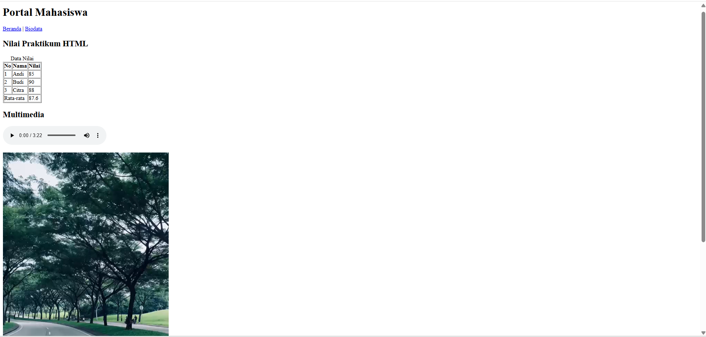
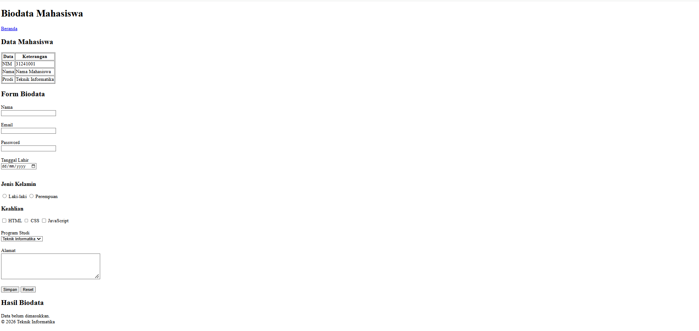

# Lab2Web

**Praktikum 2 – HTML Lanjutan**

## Jawaban Pertanyaan

### 1. Apa fungsi `<table>`, `<tr>`, `<th>`, dan `<td>`?

- `<table>` digunakan untuk membuat tabel dalam HTML.
- `<tr>` digunakan untuk membuat baris pada tabel.
- `<th>` digunakan untuk membuat sel judul atau header tabel.
- `<td>` digunakan untuk membuat sel yang berisi data pada tabel.

### 2. Apa perbedaan `<th>` dan `<td>`?

`<th>` digunakan sebagai sel judul atau header tabel yang secara default ditampilkan tebal dan rata tengah. Sedangkan `<td>` digunakan untuk menampilkan data biasa dalam tabel.

### 3. Apa fungsi colspan pada tabel?

`colspan` digunakan untuk membuat satu sel menempati beberapa kolom secara horizontal. Contohnya, `colspan="2"` berarti satu sel menempati dua kolom.

### 4. Apa fungsi `<form>` dalam HTML?

`<form>` berfungsi untuk membuat formulir yang digunakan pengguna untuk memasukkan dan mengirimkan data, seperti nama, email, password, dan informasi lainnya.

### 5. Apa perbedaan radio button dan checkbox?

Radio button digunakan untuk memilih satu pilihan dari beberapa pilihan dalam kelompok yang sama. Sedangkan checkbox memungkinkan pengguna memilih lebih dari satu pilihan.

### 6. Mengapa `<label>` sebaiknya terhubung dengan id input melalui atribut for?

Agar label terhubung dengan input yang sesuai. Ketika label diklik, input akan aktif atau terpilih. Hal ini juga meningkatkan kemudahan penggunaan dan aksesibilitas formulir.

### 7. Apa perbedaan `<textarea>` dengan input type text?

`<textarea>` digunakan untuk memasukkan teks panjang yang terdiri dari beberapa baris, seperti komentar atau pesan. Sedangkan `<input type="text">` digunakan untuk memasukkan teks dalam satu baris.

### 8. Apa fungsi semantic HTML seperti `<header>`, `<nav>`, `<main>`, `<section>`, `<article>`, `<aside>`, dan `<footer>`?

Semantic HTML digunakan untuk memberikan struktur dan makna yang jelas pada halaman web.

- `<header>`: Bagian kepala atau pengantar halaman.
- `<nav>`: Bagian navigasi atau menu.
- `<main>`: Konten utama halaman.
- `<section>`: Pengelompokan konten berdasarkan topik.
- `<article>`: Konten mandiri seperti artikel atau berita.
- `<aside>`: Konten tambahan yang berkaitan dengan konten utama.
- `<footer>`: Bagian kaki halaman, seperti informasi hak cipta atau kontak.

### 9. Apa fungsi required, min, max, dan minlength?

- `required`: Mewajibkan pengguna mengisi input sebelum formulir dikirim.
- `min`: Menentukan nilai minimum pada input yang mendukung atribut tersebut.
- `max`: Menentukan nilai maksimum pada input yang mendukung atribut tersebut.
- `minlength`: Menentukan jumlah karakter minimum yang harus dimasukkan pada input teks.

### 10. Apa perbedaan elemen `<audio>` dan `<video>`?

`<audio>` digunakan untuk memutar file suara, seperti musik atau rekaman. Sedangkan `<video>` digunakan untuk menampilkan dan memutar video yang memiliki gambar bergerak dan dapat disertai suara.

---

## Dokumentasi Hasil Praktikum

### 1. Tampilan Halaman Beranda (index.html)

### 2. Tampilan Halaman Biodata (biodata.html)

